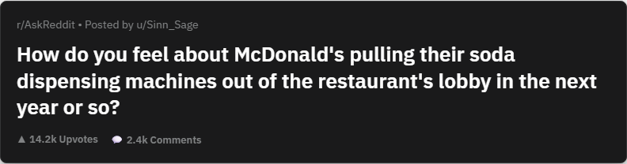
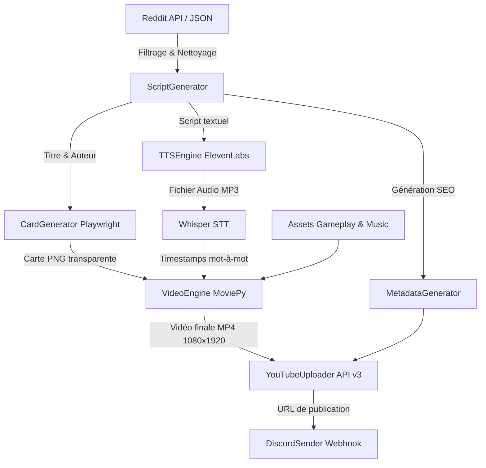

# 🎬 Reddit Shorts Automation Pipeline

[](https://www.python.org/)
[](https://playwright.dev/)
[](https://github.com/openai/whisper)
[](https://elevenlabs.io/)
[](https://zulko.github.io/moviepy/)
[](LICENSE)

Pipeline automatisé de production et publication de vidéos courtes (YouTube Shorts / TikTok / Reels) à partir d'histoires Reddit virales. Le bot orchestre l'extraction du contenu, la synthèse vocale neuronale, le rendu graphique de cartes Reddit, le montage vidéo dynamique avec synchronisation mot-à-mot, et l'upload automatisé via l'API YouTube.

---

## 📸 Aperçu du rendu visuel

<div align="center">
  
  <p><em>Exemple de carte Reddit générée dynamiquement via Playwright (rendu WebKit/Chromium haute résolution avec transparence).</em></p>
</div>

---

## ⚡ Pitch Fonctionnel & Valeur Ajoutée

La création manuelle de vidéos courtes ("storytime") est chronophage : recherche de récits sans contenu sensible, enregistrement de voix, capture de cartes Reddit, synchronisation des sous-titres karaoké, assemblage vidéo sur fond de gameplay et mise en ligne sur YouTube Studio.

**Ce projet résout l'intégralité de la chaîne sans intervention humaine :**
- 🔍 **Scraping & Modération intelligente** : Récupération des posts les plus captivants (`r/AskReddit`, `r/AITAH`, `r/TrueOffMyChest`), filtrage des sujets politiques/inappropriés via une liste noire intégrée et nettoyage regex.
- 🎙️ **Génération vocale réaliste (TTS)** : Conversion du texte en parole avec ElevenLabs (voix masculines/féminines adaptées).
- 🎨 **Moteur de cartes Reddit Headless** : Rendu HTML5/CSS3 fidèle à l'interface moderne Reddit capturé sans arrière-plan via Playwright.
- ✂️ **Montage & Synchronisation mot-à-mot** : Découpage aléatoire de fonds de gameplay verticaux (1080x1920 @ 60 FPS), mixage de la musique d'ambiance et sous-titrage synchronisé à la milliseconde grâce à **OpenAI Whisper**.
- 🚀 **SEO & Publication automatique** : Génération de métadonnées optimisées (titres accrocheurs, hashtags, tags ciblés) et publication directe sur YouTube via l'API v3 avec jeton OAuth persistant.
- 🔔 **Alertes Discord** : Notification instantanée avec lien de la vidéo dès que l'upload est confirmé.

---

## 🏗️ Architecture & Flux d'exécution



---

## 🛠️ Stack Technique Détaillée

| Domaine | Technologie | Description |
| :--- | :--- | :--- |
| **Langage** | Python 3.10+ | Moteur principal orienté batch |
| **Transcription & STT** | OpenAI Whisper (`base`) | Alignement temporel des mots pour sous-titrage dynamique |
| **Synthèse Vocale (TTS)** | ElevenLabs API v2 | Rendu vocal haute fidélité (`eleven_multilingual_v2`) |
| **Génération Graphique** | Playwright (Chromium Headless) | Capture des cartes Reddit au format PNG transparent |
| **Montage Vidéo** | MoviePy + ImageMagick | Assemblage 9:16 vertical 1080x1920, mixage audio & crop central |
| **Publication & API** | Google API Client (YouTube Data v3) | Authentification OAuth 2.0 et upload de vidéos courtes |
| **Notifications** | Discord Webhooks | Alertes de publication avec tags |
| **Planification** | Schedule / Script batch | Exécution automatisée périodique |

---

## 🚀 Démarrage Rapide

### 1. Prérequis Système
- **Python 3.10+**
- **ImageMagick** (nécessaire pour MoviePy et le rendu des sous-titres) : [Télécharger ImageMagick](https://imagemagick.org/)

### 2. Installation en 3 commandes

```bash
# 1. Cloner le dépôt et entrer dans le dossier
git clone https://github.com/NewGamer62/reddit-shorts-automation.git
cd reddit-shorts-automation

# 2. Créer l'environnement virtuel et installer les dépendances
python -m venv .venv
source .venv/bin/activate  # Sur Windows : .venv\Scripts\activate
pip install -r requirements.txt
playwright install chromium
```

### 3. Configuration des variables d'environnement

Copiez le fichier de modèle et remplissez vos clés API :

```bash
cp .env.example .env
```

Éditez `.env` :
```ini
ELEVENLABS_API_KEY="votre_cle_api_elevenlabs"
DISCORD_WEBHOOK_URL="https://discord.com/api/webhooks/..."
```

> **Note pour l'API YouTube :** Déposez votre fichier `client_secrets.json` issu de la [Google Cloud Console](https://console.cloud.google.com/) à la racine du projet. Lors du premier lancement, un onglet de navigateur s'ouvrira pour autoriser l'upload et générera `token.pickle`.

### 4. Lancement du Pipeline

```bash
python src/main.py
```
*(Ou double-cliquez sur `Start.bat` sur Windows).*

---

## 📁 Organisation du Projet

```text
├── assets/
│   ├── fonts/           # Polices personnalisées pour les sous-titres
│   ├── gameplay/        # Vidéos de fond libres de droits (Minecraft, Subway Surfers, etc.)
│   └── music/           # Bandes-son d'ambiance classées par type d'histoire
├── docs/                # Aperçus et documentation
├── output/              # Fichiers MP4 compilés et métadonnées JSON
├── src/
│   ├── card_gen_pro.py     # Générateur de cartes Reddit via Playwright
│   ├── discord_sender.py   # Envoi des webhooks Discord
│   ├── main.py             # Orchestrateur central de la pipeline
│   ├── metadata_gen.py     # Génération des tags SEO, titres et descriptions
│   ├── script_gen.py       # Récupération et nettoyage des posts Reddit
│   ├── tts_engine.py       # Wrapper de synthèse vocale ElevenLabs
│   ├── video_engine.py     # Moteur de montage vidéo, crop vertical et Whisper
│   └── youtube_uploader.py # Upload OAuth vers l'API YouTube v3
├── .env.example         # Modèle des variables d'environnement
├── .gitignore           # Exclusion stricte des vidéos lourdes et secrets
├── requirements.txt     # Dépendances Python du projet
└── Start.bat            # Lanceur rapide Windows
```

---

## 🛡️ Licence & Contribution

Projet distribué sous licence [MIT](LICENSE). Développé par **[Noa Gaillard](https://github.com/NewGamer62)**.
Les contributions et suggestions d'améliorations sont les bienvenues via Pull Request !
