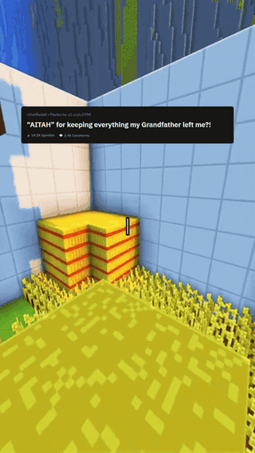
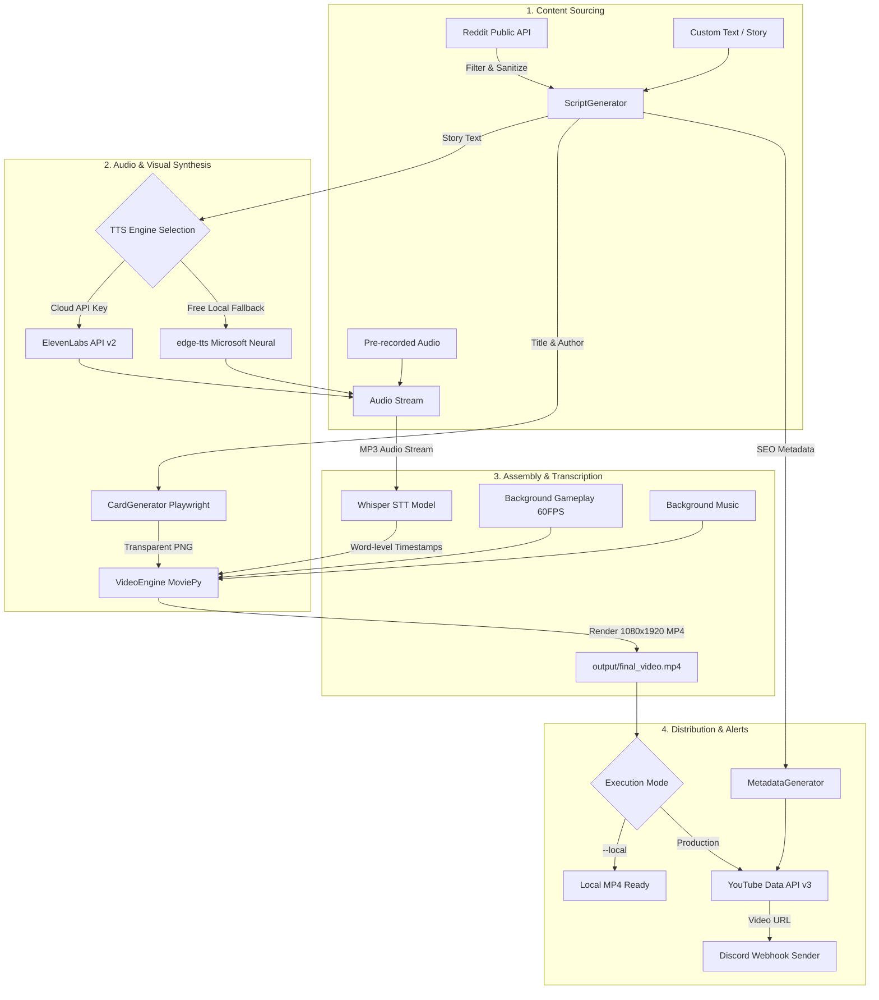

> 🌐 **Language / Langue :** **English** | [Français](README.fr.md)

# 🎬 Reddit Shorts Automation Pipeline & Agent Skill

[](https://www.python.org/)
[](https://playwright.dev/)
[](https://github.com/openai/whisper)
[](https://zulko.github.io/moviepy/)
[](https://github.com/rany2/edge-tts)
[](https://elevenlabs.io/)
[](SKILL.md)
[](LICENSE)

An open-source, automated end-to-end video pipeline that turns viral Reddit threads into monetizable 9:16 vertical shorts (YouTube Shorts, TikTok, Instagram Reels). Features headless DOM card rendering, dual-engine voiceover (ElevenLabs & free `edge-tts`), frame-accurate Whisper karaoke subtitles, 60 FPS video assembly, zero-friction local execution, and native Agensi agent skill packaging.

---

## 📸 Visual Demo

<div align="center">
  
  <p><em>End-to-end automated generation: Reddit thread scraping → Headless DOM card capture → Dual TTS audio synthesis → Whisper karaoke word-level sync → 60 FPS vertical video composite.</em></p>
</div>

---

## ⚡ Problem & Value Proposition

Manual creation of faceless "storytime" videos is tedious and time-consuming, requiring 45 to 90 minutes per video across research, voice recording, card graphic design, subtitle timing, gameplay background slicing, and upload publishing.

**This project automates 100% of the production chain with zero human intervention:**
- 🔍 **Intelligent Scraping & Moderation**: Fetches viral threads from `r/AskReddit`, `r/AITAH`, and `r/TrueOffMyChest`, automatically sanitizes text, and eliminates NSFW/sensitive content via a built-in regex blacklist.
- 🎨 **Headless Pixel-Perfect Reddit Cards**: Renders modern dark-mode Reddit cards in Chromium via Playwright and extracts transparent PNG overlays.
- 🎙️ **Dual-Engine Speech Synthesis**: Supports high-fidelity ElevenLabs neural voices or zero-friction, 100% free Microsoft Edge Neural voices (`edge-tts`).
- 📝 **Frame-Accurate Karaoke Subtitles**: Uses OpenAI Whisper (`base`) to align timestamps down to the millisecond, rendering bold karaoke-style subtitles over 9:16 vertical gameplay.
- ⚡ **Zero-Friction Local Execution**: Run tests and generate complete MP4 videos locally in seconds without any API keys or credentials.
- 🚀 **SEO & Automated Distribution**: Auto-generates high-CTR titles, descriptions, and hashtags, with direct YouTube Data API v3 upload and instant Discord webhook alerts.
- 🤖 **Agent Skill Ready**: Packaged according to Agensi standards with `SKILL.md` for seamless execution by Claude Code, Cursor, and Codex agents.

---

## 🏗️ Architecture & Execution Flow



---

## 🛠️ Technical Stack

| Domain | Technology | Role & Description |
| :--- | :--- | :--- |
| **Language** | Python 3.10+ | Batch orchestration engine |
| **Headless Rendering** | Playwright (Chromium) | Dynamic HTML5/CSS3 Reddit card generation with transparent alpha channel |
| **Speech-to-Text (STT)** | OpenAI Whisper (`base`) | Sub-second word-level timestamp alignment for dynamic karaoke subtitles |
| **Voice Synthesis (TTS)** | ElevenLabs & edge-tts | Dual engine: high-tier neural voices or free unlimited Microsoft Edge TTS |
| **Video Compositing** | MoviePy + ImageMagick | Vertical 9:16 (1080x1920) 60 FPS assembly, smart center-cropping & audio mixing |
| **Distribution** | Google YouTube Data API v3 | Automated OAuth 2.0 video upload with automated tags, categories & descriptions |
| **Monitoring** | Discord Webhooks | Real-time execution and publication notifications |
| **Agent Packaging** | Agensi `SKILL.md` | Standardized agent interface for Claude Code, Cursor, Codex, and Antigravity |

---

## 🚀 Quickstart

### 1. Prerequisites
- **Python 3.10+**
- **FFmpeg** and **ImageMagick** installed on system PATH.

### 2. Installation in 2 Commands

```bash
# Clone the repository
git clone https://github.com/NewGamer62/reddit-shorts-automation.git && cd reddit-shorts-automation

# Install dependencies and headless browser
pip install -r requirements.txt && playwright install chromium
```

### 3. Generate a Video in Zero-Friction Local Mode (No API keys needed!)

```bash
# Run local generation with free edge-tts fallback:
python src/main.py --local

# Or generate from an existing audio file:
python src/main.py --local --audio assets/audio/voiceover_AITAH.mp3
```
Your compiled video is saved immediately to `output/final_video_AITAH.mp4`.

---

## ⚙️ Production Configuration (Optional)

To enable ElevenLabs neural voices, YouTube automated uploads, and Discord notifications:

1. Copy the environment template:
   ```bash
   cp .env.example .env
   ```
2. Fill in your credentials in `.env`:
   ```ini
   ELEVENLABS_API_KEY="your_elevenlabs_api_key"
   DISCORD_WEBHOOK_URL="https://discord.com/api/webhooks/..."
   ```
3. Place your Google Cloud `client_secrets.json` at the project root for YouTube uploads.
4. Run in production mode:
   ```bash
   python src/main.py
   ```

---

## 🤖 AI Agent & Agensi Skill Integration

This repository is a first-class Agent Skill. AI coding assistants (Claude Code, Cursor, Codex, Agensi) can autonomously operate the pipeline via `SKILL.md`:

```bash
# Example agent prompt:
"Generate a 9:16 YouTube Short from r/AskReddit in local mode using edge-tts."
```

Refer to [SKILL.md](SKILL.md) for full input/output schemas and agent runbooks.

---

## 📁 Repository Structure

```text
├── assets/
│   ├── audio/           # Sample voiceovers and generated Reddit cards
│   ├── fonts/           # Custom typography (LEMONMILK-Bold.otf)
│   ├── gameplay/        # 60 FPS copyright-free background gameplay
│   └── music/           # Ambient mood soundtracks (drama, lofi, confession)
├── docs/                # Architecture diagrams, preview images, and demo.gif
├── output/              # Rendered 1080x1920 MP4 shorts and metadata JSON
├── scripts/             # Utility and automation scripts (demo GIF, GitHub metadata)
├── src/
│   ├── card_gen_pro.py     # Playwright Reddit card DOM snapshot engine
│   ├── discord_sender.py   # Discord webhook notification client
│   ├── main.py             # CLI orchestrator with zero-friction local mode
│   ├── metadata_gen.py     # High-CTR SEO tags, titles, and descriptions generator
│   ├── script_gen.py       # Reddit scraper with content moderation blacklist
│   ├── tts_engine.py       # Dual TTS engine (ElevenLabs + edge-tts fallback)
│   ├── video_engine.py     # MoviePy vertical video assembly & Whisper subtitles
│   └── youtube_uploader.py # YouTube Data API v3 OAuth uploader
├── .env.example         # Environment variable template
├── requirements.txt     # Python package requirements
├── SKILL.md             # Agensi and agent-skills specification and runbooks
├── README.md            # English portfolio documentation (this file)
└── README.fr.md         # Documentation originale en français
```

---

## 🛡️ License & Author

Distributed under the **[MIT License](LICENSE)**.  
Created by **[Noa Gaillard](https://github.com/NewGamer62)**.  
Feedback, issues, and Pull Requests are warmly welcome!
